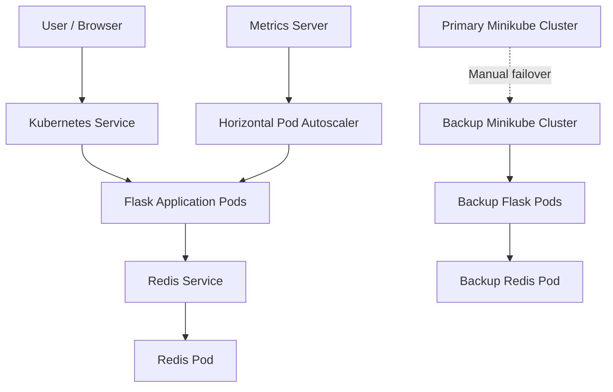

# Cloud Visitor Counter

A cloud-native Visitor Counter Web Application built using **Python Flask, Redis, Docker and Kubernetes**. The project demonstrates containerization, orchestration, horizontal autoscaling, simulated cluster failover and resource optimization.

## 1. Project Overview

The application counts website visitors using Flask and Redis. Each visit increments a counter stored in Redis, and the updated count is displayed on the web page.

### Technologies Used

- Python 3.11
- Flask
- Redis
- Docker
- Docker Compose
- Kubernetes
- Minikube
- Kubernetes Metrics Server
- Horizontal Pod Autoscaler (HPA)
- Git and GitHub

## 2. Application Features

- Real-time visitor counting using Redis.
- Flask web application with a health-check endpoint.
- Docker-based containerization.
- Multi-container deployment using Docker Compose.
- Kubernetes deployment with separate Redis and Flask services.
- Multiple application replicas.
- Readiness and liveness probes.
- Horizontal Pod Autoscaling based on CPU utilization.
- Two-cluster local failover simulation.
- Resource right-sizing and lightweight container images.

## 3. Architecture



## 4. Project Structure

```text
Cloud-Visitor-Counter/
│
├── app.py
├── requirements.txt
├── Dockerfile
├── docker-compose.yml
├── k8s.yaml
├── README.md
└── .gitignore
```

## 5. Running the Application Using Docker Compose

Build and start the application:

```bash
docker compose up --build -d
```

Check running containers:

```bash
docker compose ps
```

Open the application:

http://localhost:5001

Health-check endpoint:

http://localhost:5001/health

Stop the containers:

```bash
docker compose down
```

## 6. Kubernetes Deployment

The application was deployed on a local Minikube Kubernetes cluster.

Build the application image:

```bash
minikube image build -t visitor-counter:latest .
```

Apply Kubernetes configurations:

```bash
kubectl apply -f k8s.yaml
```

Check pods:

```bash
kubectl get pods
```

Check services:

```bash
kubectl get services
```

Access the application:

```bash
kubectl port-forward service/visitor-counter 8080:5000
```

Open http://localhost:8080

## 7. Self-Healing

Kubernetes Deployment maintains the desired number of application replicas.

When an application pod was manually deleted, Kubernetes automatically created a replacement pod and restored the desired replica count.

This demonstrates Kubernetes self-healing.

## 8. Horizontal Pod Autoscaling

Metrics Server was enabled to monitor pod resource utilization.

```bash
minikube addons enable metrics-server
```

HPA configuration:

```bash
kubectl autoscale deployment visitor-counter --cpu-percent=50 --min=2 --max=5
```

Check autoscaling status:

```bash
kubectl get hpa
```

The application demonstrated scaling from 2 to 3 replicas when CPU utilization exceeded the 50% target.

At lower utilization, the deployment operated with 2 replicas.

## 9. Hybrid Cloud and Failover Simulation

Two independent local Minikube clusters were created:

- Primary cluster: `minikube`
- Backup cluster: `backup`

The same application was deployed in both clusters.

To simulate primary-cluster failure, the primary Minikube cluster was stopped while the backup cluster remained operational.

The application continued serving requests through the backup cluster.

The primary cluster was subsequently restarted and its application pods recovered.

**Important:** This is a local two-cluster failover simulation. It demonstrates manual failover, not automatic failover or deployment on two actual public cloud providers.

## 10. Cost Optimization

Three optimization techniques were demonstrated using measured local resource and image-size data.

### A. Resource Right-Sizing

| Resource | Before | After |
|---|---:|---:|
| CPU request per pod | 100m | 50m |
| Memory request per pod | 128Mi | 96Mi |
| CPU limit per pod | 500m | 250m |
| Memory limit per pod | 256Mi | 192Mi |

CPU request reduction: 50%.

Memory request reduction: 25%.

Measured memory usage changed from approximately 57–58Mi to 55Mi per application pod.

### B. Lightweight Container Images

| Python image | Content size |
|---|---:|
| python:3.11 | 417 MB |
| python:3.11-slim | 48.1 MB |

The slim image is approximately 88.5% smaller than the standard image.

Redis was also deployed using the lightweight `redis:7-alpine` image.

### C. Horizontal Autoscaling

The application used a minimum of 2 and a maximum of 5 replicas.

During testing:
- Low CPU utilization: 2 replicas.
- Higher CPU utilization: scaled to 3 replicas.
- HPA CPU target: 50%.

This helps avoid maintaining unnecessary application replicas during lower demand.

*Note: These measurements demonstrate resource and image-size optimization. They are not direct monetary cloud-bill savings.*

## 11. Conclusion

The project demonstrates how a Flask and Redis web application can be containerized and deployed using Docker and Kubernetes.

It covers Kubernetes orchestration, service discovery, self-healing, horizontal autoscaling, simulated multi-cluster failover and resource optimization.

The implementation provides practical experience with cloud-native application deployment and container orchestration.

## 12. Repository

GitHub: https://github.com/KirtiGwalani/Cloud-Visitor-Counter
